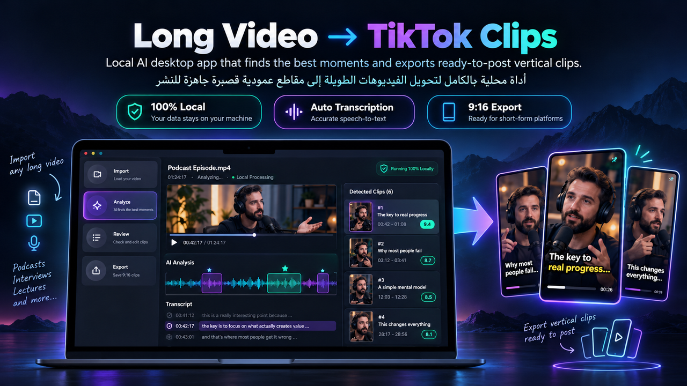

# MomentForge AI

**MomentForge AI** — من فيديو طويل إلى مقاطع عمودية جاهزة للنشر، محليًا بالكامل.



أداة محلية بالكامل تأخذ فيديو طويل (بودكاست، مقابلة، محاضرة) وتستخرج تلقائيًا
أفضل اللحظات القصيرة وتصدّرها كمقاطع عمودية (1080×1920) جاهزة لـ TikTok /
Reels / Shorts.

**كل شيء يعمل محليًا على جهازك** — لا يتم رفع الفيديو أو الصوت أو النص
المستخرج أو أي محتوى مولّد إلى أي خادم خارجي.

## التشغيل السريع (5 خطوات)

> استخدم دائمًا بايثون البيئة الافتراضية `.venv` — وليس `python` العام على الجهاز،
> لأنه لا يحتوي متطلبات المشروع.

```powershell
cd D:\coding\py\long-video-clips

# 1) أول مرة فقط: إنشاء البيئة وتثبيت المتطلبات
python -m venv .venv
.\.venv\Scripts\python.exe -m pip install -r requirements-gui.txt

# 2) Ollama في طرفية منفصلة (يحتاجه التحليل الذكي)
ollama serve
ollama pull qwen3.5:9b        # أول مرة فقط

# 3) الواجهة المكتبية
.\.venv\Scripts\python.exe desktop_app.py
```

### اختصار على سطح المكتب (بدون طرفية)

1. كليك يمين على سطح المكتب → **New → Shortcut**.
2. في **Target** ضع:

   ```
   "D:\coding\py\long-video-clips\.venv\Scripts\pythonw.exe" "D:\coding\py\long-video-clips\desktop_app.py"
   ```

3. في **Start in** ضع: `D:\coding\py\long-video-clips`
4. سمّه «MomentForge AI» — `pythonw` يشغّل الواجهة بدون نافذة كونسول.

> لو بنيت النسخة المغلّفة، أنشئ الاختصار على `dist\MomentForgeAI\MomentForgeAI.exe` بدل ذلك — فتظهر أيقونة التطبيق على سطح المكتب تلقائيًا.

### أول فيديو في 4 خطوات

1. **استيراد** → اسحب الفيديو داخل الإطار المتقطّع أو اختر ملفًا.
2. اختر إعدادًا محفوظًا (أو اضبط الخيارات) ثم **ابدأ التحليل**.
3. **المراجعة** → اختر المقاطع، عدّل التوقيت/العنوان، واقرأ النص وسبب الاختيار.
4. **التصدير** → ابدأ تصدير المختار، ثم افتح المجلد أو احفظ ZIP.

> لمعالجة أكثر من فيديو: اضبط الإعداد في **استيراد** → **الطابور** →
> «إضافة ملفات» → «ابدأ الطابور». يعمل فيديو واحد في كل مرة، ويتوقف بأمان
> عند إغلاق البرنامج أو الضغط على «إيقاف بعد الحالي».

### لو ظهرت رسالة خطأ

| الرسالة | السبب | الحل |
|---|---|---|
| `Video file not found` | المسار غير صحيح أو الملف غير موجود | مرّر المسار الكامل بين علامات تنصيص |
| `No module named 'faster_whisper'` | تشغيل بـ`python` العام | استخدم `.\.venv\Scripts\python.exe` |
| `PySide6 غير مثبت` | متطلبات الواجهة غير مثبتة | `.\.venv\Scripts\python.exe -m pip install -r requirements-gui.txt` |
| `Could not reach Ollama` | خدمة Ollama متوقفة | `ollama serve` ثم أعد المحاولة |
| `FFmpeg not found` | ffmpeg غير متاح | `pip install static-ffmpeg` داخل البيئة |

---

## المتطلبات

- Python 3.10+
- [FFmpeg](https://ffmpeg.org/) مثبت ومتاح في PATH
- [Ollama](https://ollama.com/) لتشغيل نموذج Qwen محليًا
- (اختياري) كرت شاشة NVIDIA بذاكرة 8GB+ لتسريع الترجمة والتصدير (تم اختباره
  على RTX 3070). يعمل النظام على المعالج (CPU) بدون كرت شاشة لكن أبطأ.

## التثبيت

### 1. FFmpeg

**الطريقة الجديدة (موصى بها): تلقائي عبر pip، من غير تثبيت يدوي ولا PATH**

`static-ffmpeg` موجودة أصلًا في `requirements.txt` — بمجرد `pip install -r
requirements.txt` (الخطوة اللي جاية)، أول مرة تشغّل الأداة هتنزّل نسخة
ffmpeg/ffprobe جاهزة تلقائيًا وتستخدمها، من غير ما تلمس Environment
Variables خالص.

**لو حابب تتأكد أو تفضّل التثبيت اليدوي:**

```bash
# Windows
winget install ffmpeg

# Linux
sudo apt install ffmpeg

# macOS
brew install ffmpeg

# تحقق
ffmpeg -version
```

> لو الاتنين موجودين (ثبّت يدويًا وكمان `static-ffmpeg` مثبتة)، الأداة
> بتفضّل نسخة `static-ffmpeg` تلقائيًا. ولو تحميلها فشل لأي سبب (مفيش
> إنترنت، فايروول شركة)، بترجع تلقائيًا لأي ffmpeg موجود عندك في PATH —
> يعني مفيش تعارض ولا خسارة.

### 2. بيئة بايثون

```bash
python -m venv .venv

# Windows
.venv\Scripts\activate

# Linux/macOS
source .venv/bin/activate

pip install -r requirements.txt
```

### 3. Ollama + Qwen

```bash
# ثبّت Ollama من ollama.com حسب نظام التشغيل، ثم:
ollama pull qwen3.5:9b

# تحقق
ollama run qwen3.5:9b "Say hello"
```

> **لماذا qwen3.5:9b؟** الجيل الأحدث من عائلة Qwen المتاحة على Ollama، بتحسّن
> في اتباع التعليمات وإخراج JSON منظّم ودعم جيد للعربية. عدّل الاسم وقت ما
> تحب من `--ollama-model` أو من خانة "نموذج Ollama" في الواجهة،
> وجرّب نسخة أصغر/أكبر من نفس العائلة حسب ذاكرة كرت الشاشة عندك.

---

## الاستخدام

```bash
python app.py "podcast.mp4"
```

بخيارات إضافية:

```bash
python app.py "podcast.mp4" --clips 8 --language ar --model medium
```

### الخيارات المتاحة

| الخيار | الوصف | الافتراضي |
|---|---|---|
| `--clips N` | عدد المقاطع المطلوبة | 5 |
| `--language ar\|en\|...` | فرض لغة معينة بدل الاكتشاف التلقائي | auto |
| `--model` | حجم نموذج faster-whisper (tiny/base/small/medium/large-v3) | medium |
| `--output` | مجلد الإخراج | output/ |
| `--min-duration` | أقل مدة مفضّلة للمقطع (ثانية) | 20 |
| `--max-duration` | أقصى مدة مفضّلة للمقطع (ثانية) | 60 |
| `--device` | auto / cuda / cpu | auto |
| `--ollama-model` | اسم نموذج Ollama للتقييم | qwen3.5:9b |
| `--ollama-host` | عنوان خادم Ollama | http://localhost:11434 |
| `--fix-lighting` | إصلاح إضاءة المقاطع تلقائيًا (قياس فعلي للسطوع) | متوقف |
| `--lighting-strength X` | قوة إصلاح الإضاءة (0 = متوقف، 1 = كامل، حتى 2 أقوى) | 1.0 |

### مخرجات

```text
output/
└── podcast/
    ├── clips/
    │   ├── clip_01.mp4
    │   ├── clip_02.mp4
    │   └── ...
    ├── transcript.json     # النص الكامل مع الطوابع الزمنية
    ├── candidates.json     # كل اللحظات المرشحة قبل التقييم
    └── analysis.json       # المقاطع النهائية المختارة مع درجاتها وسبب اختيارها
```

---

## الواجهة — تطبيق سطح مكتب

الواجهة الجديدة هي تطبيق سطح مكتب مستقل (PySide6) — بدون متصفح — بواجهة
عربية وإنجليزية وتغطي الرحلة: استيراد → تحليل → مراجعة →
تصدير، مع أدوات تنزيل الفيديو واستخراج الصوت والنص.

**التشغيل:**

```powershell
.\.venv\Scripts\python.exe -m pip install -r requirements-gui.txt   # أول مرة فقط
.\.venv\Scripts\python.exe desktop_app.py
```

أو استخدم الاختصار الموصوف في [التشغيل السريع](#التشغيل-السريع-5-خطوات).

النسخة الحالية تفصل **التحليل → المراجعة → التصدير**: التحليل يحفظ المقاطع
المقترحة دون تصديرها. المراجعة تسمح بالاختيار والاستبعاد وتعديل التوقيت والعنوان
والتركيز ومعاينة المصدر، ثم تصدير المختار في الخلفية، مع معاينة 360p ووضع خفيف
وإيقاف بعد المقطع الحالي والاستكمال. المشاريع تُحفظ في `projects/desktop` ويمكن
فتحها من المكتبة. العربية والإنجليزية متاحتان من قائمة اللغة.

الواجهة موحدة بالكامل في PySide6: التحميل، استخراج الصوت والنص، تقسيم الصوت،
تحرير الكابشن والكادر والمشاريع داخل نفس النافذة. **أُزيلت واجهة Streamlit القديمة**
بالكامل: التطبيق سطح مكتب أصلي فقط، بلا متصفح ولا خادم ويب.

### ما الجديد في الواجهة

- **إعدادات محفوظة (Presets):** احفظ إعداد «محاضرة / بودكاست / شورتس» باسم،
  ويُستعاد آخر إعداد تلقائيًا في المرة القادمة. أي تعديل يدوي يحوّل القائمة إلى
  «مخصص» حتى لا تحفظ بالخطأ فوق إعداد موجود.
- **الطابور:** أضف عدة فيديوهات وشغّلها متتابعة، مع حالة لكل ملف وسجل حي،
  وفحص متابعة تلقائي بعد كل فيديو.
- **مقارنة الكادر:** تبويب «الكادر» يعرض «قبل» (الإطار الكامل مع مستطيل القص)
  و«بعد» (الناتج 9:16) مع سطر `الكادر × · مركز · تقريب`، ويتحدّث تلقائيًا.
- **التحميل:** يوتيوب، فيسبوك، X (تويتر)، تيك توك، إنستجرام، وملفات مباشرة —
  مع تنبيه واضح عندما يحتاج الرابط ملف cookies.
- **المشاهدة:** شغّل الرابط داخل البرنامج مباشرة (بدون تنزيل)، مع تحكم
  تشغيل/إيقاف، صوت، وسطر يوضح مصدر البث وطريقته.
- **المكتبة:** بحث فوري باسم الفيديو أو المجلد، وزر «إزالة من المكتبة»
  يخفي المشروع فقط دون حذف أي ملف (ويبقى محميًا من أي تنظيف تلقائي).
- **إعادة المحاولة:** الطابور يعيد العناصر الفاشلة للانتظار، والتصدير يعيد
  المقاطع الفاشلة فقط دون المساس بقرارات المراجعة أو المقاطع المكتملة.
- **تحقق التوقيت:** لا يمكن تصدير مقطع نهايته قبل بدايته، والخلية تُلوَّن بالأحمر.
- **اختصارات:** `Ctrl+1..7` للصفحات، `Ctrl+O` لاختيار ملف، `Ctrl+Enter` لبدء

### تغليف EXE (اختياري)

لبناء نسخة تعمل بدون بايثون:

```powershell
.\packaging\build.ps1 -Install      # أول مرة: يثبّت PyInstaller ثم يبني
.\packaging\build.ps1               # بناء لاحق
```

الناتج: `dist\MomentForgeAI\MomentForgeAI.exe` (مجلد كامل، نحو 680MB).
لا تُضمَّن أوزان النماذج (Whisper/Ollama) — تُنزَّل عند أول استخدام. ffmpeg
مضمّن عبر `static_ffmpeg`، ونموذج الفحص البصري (`nudenet/320n.onnx`) مضمّن أيضًا.
القص الذكي (torch) مستبعد افتراضيًا لتقليل الحجم؛ أعد البناء بـ`-WithTorch` لتضمينه.

**الفحص في نسخة بدون torch:** فحص الصور يعمل كاملًا، أما تصنيف الصوت (الموسيقى)
فيعود `degraded` مع سبب واضح بدل إفشال كل المقاطع. لإعادة فحص الموسيقى داخل
البرنامج المُغلّف ابنِ بـ`-WithTorch` (يزيد الحجم كثيرًا).

**نقطة معمارية مهمة:** التطبيق يشغّل التحليل والتصدير والتحميل كعمليات فرعية.
في النسخة المُغلّفة تُستدعى عبر `MomentForgeAI.exe --run-module core.…`
(انظر `core/child_process.py`)، ولهذا تعمل داخل EXE. تم التحقق من نسخة مبنية:
`--smoke` يبني كل الصفحات، وعامل تحميل حقيقي كتب `status.json` وسجلّه بنجاح.

Windows قد يعرض تحذير SmartScreen لأن الملف غير موقّع رقميًا.

**أين تُحفظ المشاريع؟** من المصدر داخل `projects\` في المستودع. وفي النسخة
المغلّفة داخل `%LOCALAPPDATA%\MomentForgeAI` (لا داخل مجلد الحزمة `_internal`)،
حتى لا تُمحى بياناتك عند تحديث التطبيق أو إعادة بناء الـEXE.

**تشخيص سريع للنسخة المغلّفة:** `MomentForgeAI.exe --diagnose` يكتب
`diagnose.json` بجوار الملف يعرض حالة كل مكتبة (Whisper، ffmpeg، yt-dlp)
ومسار الكاش ونموذج الفحص — مفيد قبل الإبلاغ عن أي عطل.

### بنية الكود

| الملف | الدور |
|---|---|
| `desktop_app.py` | نقطة التشغيل فقط (~144 سطرًا): إنشاء التطبيق والفحص السريع |
| `ui/pages.py` | الصفحات الثمانية و`MainWindow` وأدوات التشغيل في الخلفية |
| `core/ui_theme.py` | النصوص والثيم والألوان والدوال المشتركة |

هذا الفصل يجعل كل صفحة قابلة للاستيراد والاختبار منفصلة عن التشغيل.
  التحليل، وداخل جدول المراجعة: `Space` معاينة، `X` تبديل، `Delete` استبعاد.


المعالجة والنماذج محلية. تنزيل الروابط يتصل بالموقع الخارجي. فحص المحتوى
مفعّل افتراضيًا في التصدير المكتبي، لكنه لا يضمن كشف كل مخالفة.


### المشاهدة داخل البرنامج (بدون تنزيل)

صفحة **«المشاهدة»** تفتح رابطًا وتشغّله داخل البرنامج نفسه — بدون إعلانات ولا
صفحات وسيطة، وبدون تنزيل الملف إلى القرص:

1. الصق الرابط في الحقل واضغط **«شغّل»** (أو Enter).
2. يظهر العنوان والموقع والمدة، ويبدأ التشغيل في نفس النافذة.
3. زر **«استخدم هذا الرابط للتحليل»** ينقله إلى صفحة الأدوات لتجهيز نسخة محلية
   عند الحاجة إلى تقطيع فعلي.

**زر «نزّل للمشاهدة»:** لروابط لا تدعم التقديم (يوتيوب)، ينزّل نسخة مؤقتة
(`%TEMP%\lvc-watch`) ثم يشغّلها داخل البرنامج **بتقديم كامل**؛ تُحذف النسخة
تلقائيًا عند الإيقاف أو إغلاق النافذة، وتبقى أي بقايا قديمة تُنظَّف تلقائيًا بعد يوم.

**التحكم:** تشغيل/إيقاف، تقديم وتأخير 10 ثوانٍ، شريط موضع (عند توفر التقديم)،
سرعة 0.5×–2×، مستوى صوت، وملء الشاشة بزر أو `F11` (للخروج `Esc`). تُحفَظ الجودة
والسرعة وملف cookies وتُستعاد في المرة القادمة.

**كيف يعمل؟**

- **ملف واحد (فيسبوك/X/تيك توك/ملفات مباشرة):** يُمرَّر نفس رابط الموقع عبر وسيط
  محلي على `127.0.0.1` يحمل الهيدرات الموقّعة ويدعم طلبات `Range`، فيعمل التقديم
  (Seek) بشكل طبيعي. بعض المواقع (تيك توك) ترفض العملاء العاديين بـ403 حتى مع
  الهيدرات الصحيحة، لذلك يمرّر الوسيط الطلب عبر **جلسة yt-dlp نفسها** (كوكيز +
  بصمة TLS) بدل `urllib` — وهذا ما يجعل البث يعمل.
- **يوتيوب:** لا يوفّر ملفًا واحدًا بصوت وصورة معًا، فيُدمج الفيديو مع الصوت
  على الطاير بـ`ffmpeg -c copy` ويُبَث كنتيجة fragmented MP4. النتيجة تشغيل فوري،
  لكن **التقديم غير متاح** في هذه الحالة (يظهر ذلك في سطر الوضع).
- لا يُكتب أي شيء على القرص، والوسيط يستمع على `127.0.0.1` فقط برمز عشوائي
  لكل جلسة، ويتوقف بمجرد مغادرة الصفحة.

**خيارات المشاهدة:** جودة 480p/720p/1080p، وملف cookies اختياري (Netscape .txt)
للفيديوهات الخاصة على فيسبوك/X — يُحفظ الاختيار ويُستعاد في المرة القادمة.

**حدود معروفة:** البث المباشر قد لا يعمل على كل المواقع؛ جودة البث تتبع ما يسمح به
الموقع وقد تكون أقل من المطلوب؛ التقديم غير متاح في وضع الدمج (يوتيوب).

### استخراج النص من صوت أو فيديو (زر مستقل)

جنب مسار تقطيع الفيديو، في قسم **«استخراج النص»** مستقل تمامًا: ارفع ملف
صوت (`mp3`, `m4a`, `wav`, `aac`, `ogg`, `flac`, `opus`, `wma`) أو فيديو،
واضغط **«استخرج النص»**، والأداة بتحوّلهالك:

- في مربع نص عادي تقدر تحدد منه وتنسخ مباشرة («صفحة قابلة للنسخ»).
- زر تنزيل **Word (`.docx`)** بيدعم العربية (RTL) وجاهز للفتح في Word.
- زر تنزيل **`.txt`** كمان.
- خيار **«إظهار الطوابع الزمنية»** بيحط وقت كل جملة قبل النص.

القسم ده بيستخدم نفس إعدادات Whisper من الشريط الجانبي (الحجم/اللغة/
الجهاز)، وبيشتغل محليًا بالكامل — بدون أي رفع لأي مكان.


### تقسيم الصوت (نفس فكرة تقسيم الفيديو)

قسم **«✂️ تقسيم الصوت»** مستقل كمان: ارفع صوت (أو فيديو وهناخد الصوت بتاعه)
واختار إما **عدد الأجزاء** (طول الجزء = طول الملف ÷ العدد) أو **مدة كل جزء**
بالثواني، واضغط **«قسّم الصوت»**.

- الأجزاء بتطلع mp3 (أو m4a لو نسخة ffmpeg عندك من غير MP3) جاهزة للاستماع والتنزيل.
- في زر بيحزّم كل الأجزاء في ملف ZIP واحد.
- لو الطلب هيطلع جزء أقصر من 3 ثواني، الأداة ترفض بصراحة وتقولك أقصى عدد معقول.


### عدد المقاطع: افتراضي ذكي حسب طول الفيديو

لو ما حددتش `--clips`، الأداة بتحسب رقم مناسب تلقائيًا بناءً على مدة
الفيديو (تقريبًا مقطع كل 4 دقائق، بحد أدنى 5 وحد أقصى 25)، وبتعرض عليك
رسالة واضحة قبل ما تبدأ:

```
This video is about 59 minutes long. You didn't set --clips, so by
default this tool will create 15 clips (covering up to ~15 of the 59
minutes - the rest of the video won't be used).
Press Enter to continue with this, type a different number of clips,
or 'n' to cancel and adjust settings yourself:
```

اضغط Enter للموافقة، اكتب رقم مختلف وEnter، أو اكتب `n` للإلغاء وتعديل
`--clips`/`--max-duration` بنفسك. لو محتاج تشغيل بدون تفاعل (سكريبت
آلي)، استخدم `--yes` لتخطي السؤال.

في الواجهة، نفس الفكرة تظهر كرسالة تنبيه فوق شريط "عدد
المقاطع" بمجرد رفع الفيديو، وتقدر تعدّل الرقم من الشريط مباشرة قبل
الضغط على "ابدأ المعالجة".

### ليه بيطلع عدد مقاطع أقل من المطلوب؟ (وبقى بيتحل إزاي)

لو طلبت عدد مقاطع أكبر مما الفيديو يقدر عليه، الأداة **مش بتسكت**:

1. **تظبيط طول المقطع تلقائيًا (Adaptive band):** لو `عدد المقاطع × أقصى
   مدة` أكبر بكتير من طول الفيديو (مثال: 5 مقاطع × 60 ثانية = 300 ثانية
   من فيديو مدته 56 ثانية بس)، الأداة بتصغّر أقصى طول للمقطع لحد
   `طول الفيديو ÷ عدد المقاطع` — يعني 11 ثانية في المثال ده — بحيث
   الـ 5 مقاطع ينفع يطلعوا فعلًا من غير تداخل. التصغير ده **بس** للأسفل،
   وعمره ما يتعدى `--min-duration`/`--max-duration` اللي أنت حددتهم،
   وعمره ما ينزل تحت 8 ثواني.

2. **حد الاستطاعة (Feasibility guard):** لو حتى بعد التصغير الفيديو مش
   قادر يستوعب العدد المطلوب، بتظهرلك رسالة صريحة: "الفيديو 30 ثانية
   بس، وأقصى عدد مقاطع من غير تداخل هو 4، يعني 20 مستحيل" — في سطر
   الأوامر قبل ما تبدأ، وفي الواجهة فوق شريط عدد المقاطع.

3. **تقرير واضح بالأرقام في الآخر:** لو الناتج أقل من المطلوب لأي سبب
   تاني، بتطلعلك بلوك واحد فيه السبب بالأرقام، مثال:

```text
Produced 3 of 20 requested clip(s). Why:
  - LLM ranking: 2/4 batch(es) produced scores, 2 failed outright -> 12 of 64 candidates got a score
  - 9 candidate(s) overlapped an already-kept clip by more than 30%
  - the source is 30s long and can hold at most 4 non-overlapping clip(s) of 8-8s,
    so 20 was never physically possible
  Fixes: raise --max-duration (or lower --clips), or lower --min-score-threshold ...
```

4. **إعادة محاولة تقييم Qwen عند الفشل:** لو دفعة (batch) من المرشحين
   فشلت أو رجعت JSON مش سليم، الأداة بتعيد المحاولة، ولو فشلت تاني
   بتقسّمها نصفين وتعيد عليهم — بدل ما ترمي جزء كامل من الفيديو.
   اللي يضيع فعلًا بيظهر في التقرير فوق.

> ملاحظة: `--clips N` دايمًا بيكسب — الرقم اللي بتكتبه هو اللي بيتنفّذ،
> والأداة بس بتظبط طول المقطع وتقولك لو الرقم مستحيل.

## الكابشن والعنوان التلقائي — اختياري

```bash
python app.py "video.mp4" --captions --title-overlay
```

- `--captions`: ترجمة نصية قصيرة (4-6 كلمات في المرة) تظهر أسفل الفيديو،
  متزامنة تلقائيًا مع الصوت (تحتاج طوابع زمنية لكل كلمة، مفعّلة افتراضيًا).
- `--title-overlay`: عنوان جذاب يولّده `qwen3.5:9b` تلقائيًا لكل مقطع (ضمن
  نفس استدعاء التقييم، بدون تكلفة إضافية)، يظهر أعلى الفيديو في أول 4
  ثواني.

بيضيفوا تمريرة `ffmpeg` إضافية لكل مقطع (إعادة ترميز)، فمتوقع ثواني
معدودة زيادة لكل مقطع، مش دقايق.

### تصحيح الكابشن (الكلمات المتشابهة صوتيًا)

Whisper قد يكتب «المزهر» بدل «المذهب». في **استيراد ← إعدادات متقدمة**:

- **قاموس تصحيح الكابشن:** سطر لكل تصحيح بصيغة `الخطأ => الصحيح`
  (يمين السطر = الخطأ، ويساره = الصحيح). التعليقات تبدأ بـ`#`.
- **كلمات متوقعة للتفريغ:** تُمرَّر إلى Whisper كـ`hotwords` لتوجيه المفردات
  قبل التفريغ أصلًا.

القاموس يُطبَّق بعد التفريغ على **نص المقاطع وكلماتها**، فيظهر في الكابشن المدمجة
والنص المصدَّر والترتيب، ويُسجَّل عدد التصحيحات في سجل التحليل
(مثال: `Caption corrections: 3 تصحيحًا: المزهر => المذهب ×2`).

من سطر الأوامر:

```bash
.venv\Scripts\python.exe app.py lecture.mp4 --glossary-file glossary.txt --asr-hotwords "ابن تيمية, المذهب"
```

الإعدادان محفوظان مع الـpresets، والقاموس يُتحقَّق منه قبل بدء التحليل (خطأ في
الصيغة يظهر كرسالة واضحة بدل تجاهل صامت).

## إصلاح الإضاءة تلقائيًا — اختياري

```bash
python app.py "video.mp4" --fix-lighting
python app.py "video.mp4" --fix-lighting --lighting-strength 0.6
```

أو فعّل مربع **"إصلاح الإضاءة تلقائيًا"** في الشريط الجانبي للواجهة
الرسومية (وتحته سلايدر "قوة إصلاح الإضاءة").

المقاطع اللي بتتطلع من فيديوهات قديمة أو إضاءتها ضعيفة بتبان باهتة أو
معتمة على تيك توك. الخيار ده بيقيس سطوع كل مقطع **فعليًا من الفيديو
الأصلي** قبل التصدير، وبعدين يحسب تصحيح مناسب ليه — مش رقم ثابت
متكرر لكل المقاطع.

### إزاي بيشتغل بالظبط

1. **قياس:** بيقرأ إحصائيات الإضاءة الحقيقية للمقطع من الفيديو بـ
   `ffmpeg signalstats` (متوسط/أقل/أعلى قيمة luma)، مع القفز مباشرة
   لبداية المقطع وعيّنة كل ثانية تقريبًا — فالتكلفة أجزاء من الثانية،
   مش إعادة قراءة الفيديو كله.
2. **حساب:** بيحوّل المتوسط المقيس لنطاق المعدّل الصحيح (`eq` gamma
   وcontrast وbrightness) بحيث المتوسط يقرب من هدف وسط الإضاءة
   (118 من 255 افتراضيًا).
3. **تقييد (Clamping):** التصحيح محدود بحدود آمنة:
   - مقطع معرّض صح (فرقه ≤ 6 عن الهدف) **مش بيتغيّر خالص**.
   - مقطع معتم جدًا بيتفتح بقدر معقول من غير ما يتحرق (الهايلايتس
     محمية، والتفاصيل اللي مش موجودة أصلًا مش بيتم اختراعها).
   - المقطع الفاتح زيادة بيتهدّى لنفس الهدف، وmش بينزل لحد ما يبقى
     معتم.
   - `--lighting-strength` بيتحكم في قوة التصحيح (0 = مفيش، 1 = التصحيح
     الكامل المحسوب، حتى 2 = أقوى — وبرضه جوّه نفس الحدود الآمنة).
4. **تحقّق:** بعد الرندر، الأداة بتعيد قياس المقطع الناتج وتطبع
   `measured YAVG 52.1 -> 100.4` في السجل، فتشوف بعينك النتيجة الفعلية
   مش مجرد توقّع.

### ملاحظات

- **متوقف افتراضيًا** — مفيش أي تغيير في سلوك الأداة لو مفعّلتوش.
- بيشتغل على **الطريقتين**: القص المركزي العادي (`--smart-reframe` غير
  مفعّل) والقص الذكي، لأنه بيتحقن في نفس سلسلة فلاتر الرندر — يعني
  التصحيح بيتطبق مرة واحدة ويكون متطابق في الحالتين.
- بيتوافق مع `--captions`/`--title-overlay`: الإضاءة بتتصلح على الفيديو
  نفسه، والكابشن/العنوان بيتحرقوا بعدها فوقه.
- **مفيش أي مكتبة جديدة** — كله ffmpeg الموجود أصلًا.
- لو القياس فشل لأي سبب، المقطع بيتصدّر زي ما هو مع تحذير في السجل —
  مش هيوقف التصدير.

## تعديل المقاطع يدويًا قبل التصدير

**في الواجهة:** الزر بقى مقسوم لمرحلتين — "🔍 حلّل الفيديو" يوقف
بعد الترجمة والتقييم ويعرض قائمة بكل مقطع مع حقول لتعديل وقت البداية/
النهاية، ثم "🚀 صدّر المقاطع النهائية" يصدّر بالقيم المعدّلة.

**في سطر الأوامر:** شغّل الأداة عادي (بينتج `analysis.json` داخل مجلد
المشروع كالعادة)، عدّل قيم `start`/`end` في الملف يدويًا، ثم:

```bash
python app.py "video.mp4" --render-from output/video/analysis.json --captions
```

ده بيتخطى الترجمة والتقييم بالكامل ويصدّر مباشرة من القيم اللي عدّلتها —
مفيد لو عايز تجرب تعديلات مختلفة بسرعة بدون انتظار خط الأنابيب كامل تاني.

## القص الذكي (Smart Auto-Reframe) — اختياري

بدل القص المركزي الثابت (الافتراضي)، يقدر النظام يتتبع الوجه/المتحدث في
الفيديو ويحرّك نافذة القص العمودية تلقائيًا لتتبعه — ويتحول للقطة عامة
(خلفية مموّهة + الفيديو كامل في المنتصف) لو فيه أكتر من شخص أو محدش ظاهر.

> مأخوذ ومُعاد تنظيمه من مشروع [mutonby/openshorts](https://github.com/mutonby/openshorts)
> (رخصة MIT)، وهو نفسه فرع من [kamilstanuch/Autocrop-vertical](https://github.com/kamilstanuch/Autocrop-vertical).

### التثبيت

```bash
pip install -r requirements-smart-reframe.txt
```

### الاستخدام

```bash
python app.py "podcast.mp4" --smart-reframe
```

أو فعّل مربع "القص الذكي" في الواجهة.

### ملاحظات مهمة

- **أبطأ بشكل ملحوظ** من القص المركزي الافتراضي — بيمر على الفيديو
  فريم-بفريم بدل أمر ffmpeg واحد سريع، فيتحول الرندر من أجزاء الثانية إلى
  ثواني/دقائق حسب طول المقطع وقوة الجهاز.
- أول تشغيل هينزّل نموذج YOLOv8n (~6MB) تلقائيًا من الإنترنت.
- مناسب أكتر للفيديوهات اللي فيها متحدث واحد أو أكتر بيتحركوا في الكادر
  (بودكاست بكاميرتين، مقابلة). مش هيفرق كتير في فيديو ثابت بكاميرا واحدة
  في المنتصف أصلاً.

## كيف يعمل خط الأنابيب

```text
الفيديو → استخراج الصوت → faster-whisper (ترجمة+طوابع زمنية)
        → توليد لحظات مرشحة → تقييم/ترتيب عبر Qwen (محلي عبر Ollama)
        → تنظيف الحدود وتوسيع السياق → إزالة التكرار/التداخل
        → (اختياري) قياس إضاءة كل مقطع وإصلاحها
        → تصدير عمودي عبر FFmpeg (NVENC إن توفر، وإلا CPU)
```

كل مرحلة معزولة في وحدة مستقلة (`core/`) بحيث يمكن استبدال أي جزء لاحقًا
(مثل استبدال القص المركزي بـ Smart Auto-Reframe) دون تعديل بقية الأنابيب.

## حدود النسخة الأولى (MVP) — مقصودة

هذه النسخة **لا تتضمن عمدًا**: معالجة سحابية، حسابات مستخدمين، ترجمات/كابشن
تلقائي، واجهة رسومية، معالجة دفعية لعدة فيديوهات، أو نشر مباشر على منصات
التواصل. هذه كلها ضمن خارطة الطريق المستقبلية بعد أن يثبت خط الأنابيب
الأساسي أنه موثوق.

## استكشاف الأخطاء الشائعة

- **"FFmpeg was not found"** → تأكد من تثبيت FFmpeg وإضافته لـ PATH.
- **"Could not reach Ollama"** → شغّل `ollama serve` وتأكد من سحب النموذج
  بـ `ollama pull qwen3.5:9b`.
- **"CUDA requested but not available"** → سيتم التراجع تلقائيًا للمعالج
  (CPU)، وهذا طبيعي إن لم يوجد كرت NVIDIA متوافق.
- **"بيطلع مقطع واحد بس" (أو أقل من العدد المطلوب)** → كانت مشكلة في
  فيديوهات قصيرة مع عدد مقاطع كبير: كل المرشحين كانوا بيمتدوا على معظم
  الفيديو، فبيتداخلوا مع بعض وبيتحذفوا كلهم إلا واحد. دلوقتي الأداة
  بتظبط طول المقطع تلقائيًا لعدد المقاطع المطلوب وبتقولك صريح لو الرقم
  مستحيل على الفيديو ده (شوف "ليه بيطلع عدد مقاطع أقل من المطلوب؟").
- **"المقاطع باهتة أو معتمة"** → فعّل `--fix-lighting` (أو مربع "إصلاح
  الإضاءة تلقائيًا" في الواجهة).
- **لا توجد مقاطع نهائية** → جرّب تخفيض `--min-duration` أو تأكد أن الفيديو
  يحتوي كلامًا واضحًا (وليس صمتًا أو موسيقى فقط).

## ملاحظة حول اعتماديات Ollama

تم تنفيذ الاتصال بـ Ollama عبر REST API مباشرة (بدون حزمة `ollama`
البايثونية) لتقليل الاعتماديات غير الضرورية، تماشيًا مع مبدأ "لا تضف
اعتماديات إلا عند الحاجة الفعلية".

---

## المميزات المحلية (تحديثات ما بعد الإصدار الأساسي)

### وضع التغطية الكاملة (للمحاضرات)
من الواجهة: فعّل **"تغطية المحاضرة كاملة (أجزاء متتالية بنفس الطول)"** واختار طول
الجزء (30–90 ثانية) — التطبيق يقسّم **المحاضرة كلها** لأجزاء متتالية تغطي ~100% من
المدة (بدل اختيار أفضل اللحظات فقط). من سطر الأوامر:

```bash
python app.py "lecture.mp4" --cover-full --part-length 60
```

- الأجزاء متتالية: كل جزء يبدأ من حيث انتهى السابق (تداخل صغير ≤~4 ثواني عند
  اللواصق فقط، بدون تكرار حقيقي).
- الجودة مُعطّلة عمداً في هذا الوضع (أولوية التغطية)، والحدود لسه على فواصل
  الأنفاس/الكلمات الطبيعية.

### فلتر الكلمات البذيئة في الكابشن
أي كلمة في `profanity.txt` (كلمة لكل سطر، `#` للتعليق) بتتمسّح من **الكابشن المحروق
والعناوين** قبل كتابة ملف الـass:

- مطابقة **كلمة كاملة** فقط — "بز" تُمسك، "بزاف" لا.
- الحجب بنجوم بعدد الحروف مع الحفاظ على الترقيم والتوقيتات.

### رفع الفيديوهات الكبيرة
- حد الرفع مرفوع إلى **4 جيجا**.
- الأفضل للمحاضرات: **الصق مسار الملف** في حقل "أو الصق مسار ملف الفيديو مباشرة"
  — من غير رفع خالص (Shift + كليك يمين → Copy as path).

### الاستكمال بعد أي انقطاع
- الترجمة/المرشحات/التقييمات/الكليبات المصدرة بتُحفظ مع بصمة إعداداتها في
  `output/.../` — إعادة التشغيل بنفس الفيديو والإعدادات **تكمّل من آخر مرحلة**.
- من ضبط الواجهة: خيار "استكمال من آخر نقطة" (مفعّل افتراضياً).

### تحسينات أخرى
- سياق Ollama مضبوط صراحة (`num_ctx=8192`) — دفعات التقييم الطويلة لا تُقطع.
- القص على حدود الكلمات/الأنفاس (مفيش قطع في نص كلمة).
- أزرار التحميل بقت روابط سيرفر محلي — تشتغل مع أي حجم ملف.
- مجلدات العمل المؤقتة تُنظّف تلقائياً (أقدم من 72 ساعة) وتحمي الجلسة الشغالة.


### Coverage and podcast layout

Full coverage partitions the entire source, including silence and the final tail.
Ollama ranking is skipped. Whisper is optional unless burned captions are selected;
failed transcription preserves coverage and is reported. Shared boundaries are not
independently moved during export. Manual edits and failed exports are reflected in
the coverage report in the interface.

Smart reframe supports `--smart-reframe --reframe-layout stacked` and
`--podcast-top-share 0.6`. The source's left person appears above the right person.
This is a spatial layout, not audio-based active-speaker detection. When both faces
are unavailable, it returns to the complete frame. The default single-person tracker
returns to the complete frame after prolonged detection loss.

Rendered clips are reused only when source identity, transcript, title and export
settings match, and only when resume is enabled.


### Contextual highlights and speaker focus

The default "complete ideas" strategy in the interface and CLI `--candidate-strategy hybrid`
ask Ollama to propose complete spans using transcript segment IDs, then validate and
rank them alongside the original window candidates. Out-of-range IDs and invented
timestamps are discarded. Failed proposals fall back to windows. Full coverage skips
this stage. This adds local model calls; `windows` keeps the original faster strategy.

`--podcast-focus left|right` manually prioritizes a source side. In stacked mode, left
stays above right, with the preferred side receiving more space. `auto` is experimental:
normalized lower-face motion during audible sound estimates a side, with sustained
evidence and switch hysteresis. It does not identify voices or perform diarization.
Music, off-screen speech, camera motion and occluded faces can confuse it. Unknown
confidence preserves both people; manual focus is available.

Audio splitting can now move shared boundaries to speech pauses using Whisper while
retaining complete source coverage. Text extraction also offers timed `.srt` export.
Caption groups stop at pauses and sentence endings instead of spanning long silence.

Idea proposals are checkpointed per transcript excerpt. Changing the transcript,
Whisper settings or model configuration invalidates the relevant cached results.


### Review and progressive exports

The review table in the interface saves selections, timings, titles, and focus per clip.
Unchecked clips are excluded. Rejected clips can be replaced with an unused,
non-overlapping candidate from the saved model scores when one is available.

Exports run in a separate local process, one clip at a time. Completed clips
appear immediately. Stop after the current clip, then resume using the same
settings to reuse verified completed files. A 360p preview has its own output
directory; disable preview to export the final resolution. Light mode limits
encoder and Torch threads. Estimated remaining time appears after the first clip.
Review decisions and the analysis snapshot survive reopening the same source.
Edited titles still pass the mandatory title safety gate. ZIP creation is optional.


### Download before analysis

Open the URL download section for YouTube/Shorts, TikTok, Facebook, Instagram
or direct video links. Inspect a single recorded video, choose a maximum
resolution (720p default) and a local folder, then download in the background.
Cancel preserves partial files; restart with the same URL, folder and quality
to continue. Completed files are reused while their size/modification time match.
Select the completed file for analysis explicitly; downloading never starts clipping.
Playlists, active live streams and videos declared age 18+ are rejected.
This age-label check is not a visual nudity/music detector.

Install dependencies with `python -m pip install -U "yt-dlp[default]"`.
YouTube also requires Node 22+ or Deno 2.3+; Node is detected on PATH or
from the existing bundled local runtime. FFmpeg is reused from static-ffmpeg.
Optional Netscape cookies are supplied by local file path, copied for the worker
and removed from its job folder afterwards; browser cookies are not read automatically.
Some sites require login or may change their download behavior.

### Standalone audio extraction

Use the audio extraction section with the selected/downloaded video, a separate upload, or a local path. Export full audio or a time range in the background as MP3 (128-320 kbps) or mono 16 kHz PCM WAV. Finished audio can be downloaded or selected directly for the independent text extraction and audio splitting sections. No Whisper or Ollama model runs just to extract audio. Existing completed files are reused only while their file metadata matches, and failed exports preserve any previous output.


### Review, projects and conservative screening

Low-confidence automatic language detection requires an explicit language choice.
When sentence-based candidate generation produces nothing, word timestamps provide
bounded fallback proposals, which still undergo the normal scoring/quality rules.
The caption editor saves text and timing changes; changed lines render as whole
caption units, while unchanged lines retain their original word timing.
Manual single-speaker crops support center/zoom controls and source-frame previews.
The project library restores saved review snapshots and protects registered
temporary project folders from the age-based cleanup sweep.

Optional conservative pre-export screening uses NudeNet on one video frame per
second and MIT AST AudioSet classification on consecutive audio windows. Findings
or unavailable models prevent automatic export of that clip. This is probabilistic
screening, not a guarantee or religious judgment; brief visual content may be missed.
AST weights are stored locally in `models/audio-screening` and loaded offline.
The GUI enables screening by default; it adds CPU work before each export, and
successful scan results are cached by source and exact clip boundaries.

### Native desktop export and discovery controls

Import provides hybrid complete-idea discovery or scored time windows. In Highlights mode, enable manual duration to override the platform's minimum/maximum; full coverage continues to use its part duration. With smart framing and stacked podcast layout, set the top speaker area from 50% to 70% (default 60%).

Review offers best-three-only export from the currently selected clips, ranked by model score. Selections and edits are preserved; turn this option off to export the remaining selected clips, reusing verified outputs where settings match. Export can save a ZIP of currently completed clips while the export queue continues. ZIP runs in a background thread, streams files without recompression, and replaces the destination only after successful completion.
